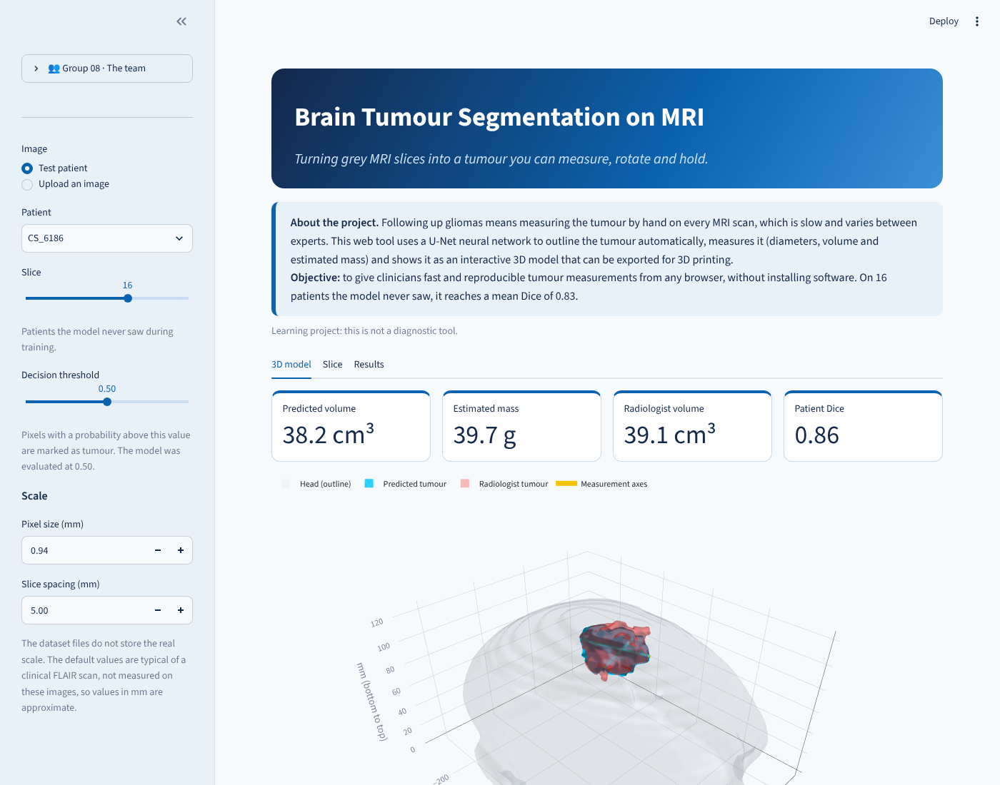
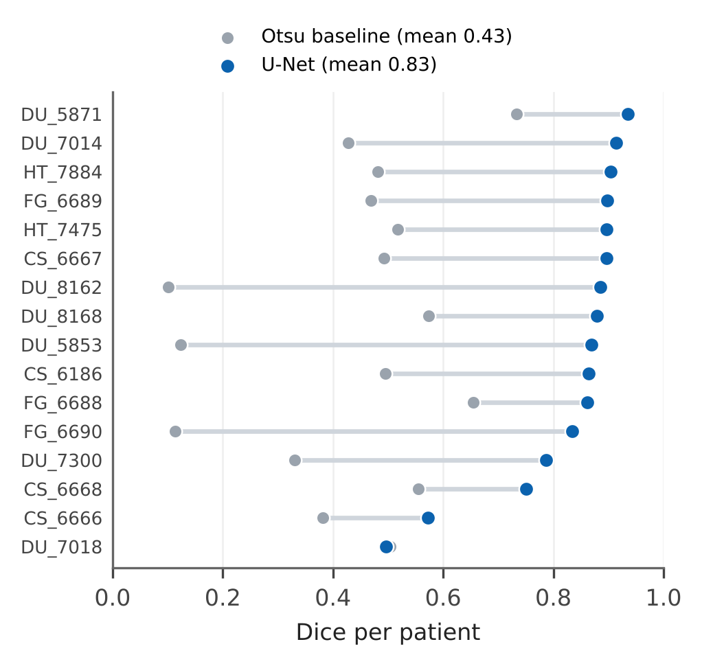
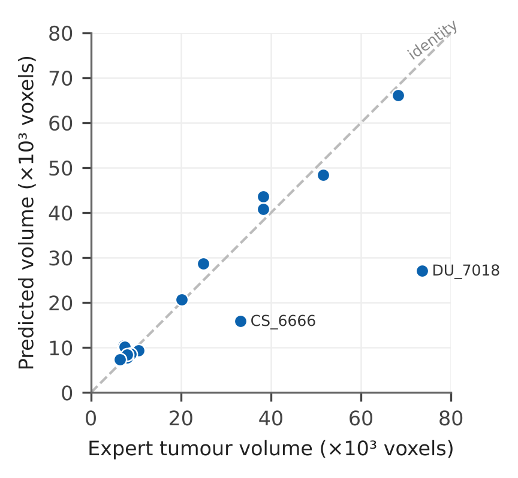
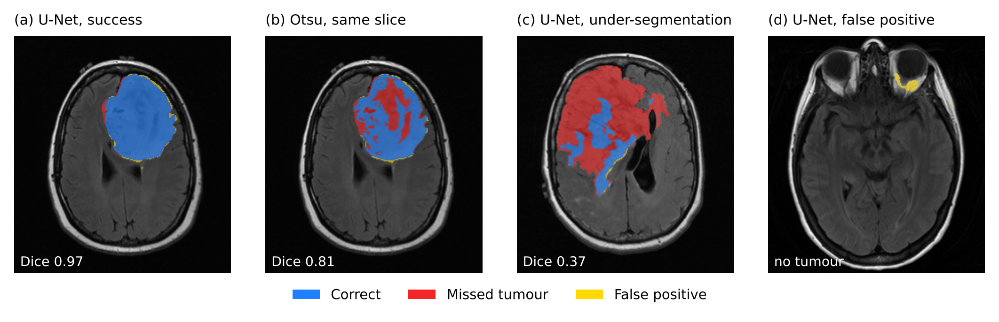

# Brain Tumour Segmentation on MRI

*Turning grey MRI slices into a tumour you can measure, rotate and hold.*

A U-Net trained from scratch in PyTorch to outline lower-grade gliomas on brain MRI slices, measure them and show them as an interactive 3D model. On 16 test patients the model never saw, it reaches a **mean Dice per patient of 0.83 ± 0.12** (median 0.87).

**Live demo:** https://segmentacion-tumores-mri.streamlit.app

> Learning project. It is not a diagnostic tool and must not be used as one.

**Group 08** · Diego Corrales · Blanca Acón · Telmo Careaga · Leire Badiola
Introduction to Biomedical Engineering, Final Project 2026–2027 · University of Deusto
Supervisors: Begoña García-Zapirain Soto · Cyrille Kesiku Yetuyetu

## Why

Gliomas are followed up with repeated MRI scans, and each scan has to be measured to decide whether the tumour is growing. Doing it by hand is slow and varies between experts, so a tool that outlines and measures the tumour automatically, and shows it in 3D, can save time and make the follow-up more reproducible. The objective of this project is to give clinicians fast, reproducible tumour measurements from any browser, without installing software.

## The web application

The app is built with Streamlit and runs on Streamlit Community Cloud. It includes the 16 test patients, so it works without the full dataset.

- **3D model** (first tab): surface of the predicted tumour and of the radiologist's segmentation, a transparent head outline for orientation, and the measurement axes on the slice where the tumour is largest. Each layer is shown or hidden with one click on the legend. Shows the predicted volume, the estimated mass, the radiologist's volume and the patient's Dice.
- **Slice**: browse the slices of a patient and see the FLAIR image, the prediction over the radiologist's contour and the probability map. Shows the area, the longest and perpendicular diameters (the bidimensional measurement used to follow gliomas, RANO) and their product. The decision threshold and the scale can be changed in the controls.
- **Results**: how the model was evaluated, the comparison with a classical method, the analysis of errors and the limitations.
- **Downloads**: the predicted tumour as an **STL file** in millimetres for 3D printing, and a one-page **PDF report** of the patient with all the measurements, the largest slice and the 3D view.
- **Upload**: a user can also upload an MRI slice of their own (256×256, three sequences) to get the segmentation of that slice.
- **Mobile layout**: when the page is opened on a phone, the controls move from the side panel into the page and the layout becomes more compact. On a computer the layout does not change.
- **Team panel**: the members of the group, with photos, in a drop-down panel in the top-left corner.

The predictions of the 16 test patients are stored with the data, so the 3D model opens instantly.

## Test results

Metrics per patient, adding up the pixels of all their slices. The test set was evaluated only once, with the model already fixed.

| Metric | Mean ± SD | Median |
|---|---|---|
| Dice | 0.828 ± 0.124 | 0.874 |
| IoU | 0.721 ± 0.156 | 0.776 |
| Sensitivity | 0.843 ± 0.190 | 0.908 |
| Precision | 0.848 ± 0.077 | 0.860 |

The worst patient scores 0.497 and the best 0.935. Only 2.5% of the slices with tumour are missed.

As a reference, the original paper on this dataset (Buda et al., 2019) reports a mean Dice of 82%. The figures are not directly comparable: that work evaluated all 110 patients, and this one 16 patients with a single split.

## Was deep learning needed?

The U-Net was compared with a classical method that does not learn: chained Otsu thresholds on the FLAIR image, plus morphology to remove the skull and keep the largest bright region.

| | Otsu thresholding | U-Net |
|---|---|---|
| Dice | 0.435 ± 0.186 | 0.828 ± 0.124 |
| IoU | 0.294 | 0.721 |
| Sensitivity | 0.528 | 0.843 |
| Precision | 0.443 | 0.848 |
| Healthy slices with something marked | 63.0% | 11.1% |

The U-Net is better in 15 of the 16 patients (Wilcoxon signed-rank test, p < 0.001).

A threshold can outline an obvious bright lesion, but it always finds "the brightest thing" in the image, so it marks something in almost two out of three healthy slices. Outlining an obvious tumour does not need a neural network; deciding whether there is a tumour and where, does. The parameters of the classical method were set by hand and not tuned, so it could do somewhat better.

Predicted and radiologist volumes are correlated (Pearson r = 0.83), with a median absolute difference of 12.8%.

## How the model fails

*Blue: correct. Red: tumour missed. Yellow: marked but not tumour. (a) U-Net success; (b) Otsu on the same slice; (c) a large, heterogeneous tumour only partly found; (d) a false positive in the orbit.*

**Small tumours.** Performance depends on the size of the lesion in the slice.

| Tumour in the slice | Slices | Mean Dice | Missed |
|---|---|---|---|
| Small (< 500 px) | 34 | 0.559 | 11.8% |
| Medium (500–2,000 px) | 87 | 0.839 | 1.1% |
| Large (> 2,000 px) | 83 | 0.813 | 0% |

**Very large, heterogeneous tumours.** In the two worst patients precision is high and sensitivity low: what the model marks is tumour, but it leaves a large part out. In the case reviewed, it segments the bright FLAIR component and gives almost zero probability to the dimmer rest of the lesion. Lowering the decision threshold does not fix it.

**False positives.** The model marks something in 41 of the 368 healthy slices. Only 10 are next to the beginning or end of the tumour, and 12 are spots larger than 200 pixels. They appear on structures that are bright on FLAIR without being a lesion, such as the orbits and the skull base, and on the highest slices.

## About the measurements

The values in millimetres, the volume and the mass are approximate for three reasons:

- **The scale is not in the data.** The Kaggle images do not store the real pixel size or the distance between slices. The app uses 0.94 mm per pixel and 5 mm between slices by default, typical values for a clinical FLAIR scan, and both can be changed. Patients have between 20 and 88 slices, so the real spacing changes from one to another, and the volume is the most sensitive measurement.
- **The mass is an estimate:** the volume multiplied by 1.04 g/cm³, an approximate density of brain tissue.
- **The mask covers the abnormality visible on FLAIR,** which includes tumour and oedema, not only tumour cells.

The head outline in the 3D view is the skin surface detected on the MRI and is shown only for orientation.

## From the first version to the second

The first training looked reasonable by its metric (mean Dice per slice of 0.78), but when broken down it turned out to be a model that hardly segmented anything. Validation results:

| | Version 1 | Version 2 |
|---|---|---|
| Dice per patient | 0.527 | 0.816 |
| Tumour slices missed | 35.3% | 4.7% |
| Healthy slices with something marked | 2.6% | 7.1% |

What we learned:

- **The metric was misleading.** Two out of three slices have no tumour, and an empty slice with nothing marked counts as Dice 1, so a model that marks nothing scored 0.62. We switched to measuring per patient.
- **The selection criterion rewarded not marking.** Saving the best model by that metric picked the most cautious one.
- **Brightness depends on the scanner.** Three patients from the same hospital, with darker images, had Dice 0. Normalising each channel of each image raised them to 0.82, 0.82 and 0.93.

Version 2 changes five things at once: per-image normalisation, sampling that balances slices with and without tumour, selection by Dice per patient, a decreasing learning rate and more epochs. As they were applied together, the contribution of each one is not known.

## Data

LGG Segmentation Dataset: brain MRI of 110 patients with lower-grade glioma from The Cancer Genome Atlas, from 5 institutions. There are 3,929 slices of 256×256 pixels with three channels (pre-contrast, FLAIR and post-contrast) and a mask drawn by a radiologist; 34.9% of the slices contain tumour.

The split is done **by patient**, not by slice, so that neighbouring slices of the same brain never end up in different sets: 78 patients for training, 16 for validation and 16 for test (2,744, 613 and 572 slices).

## Model and training

- **Architecture:** four-level U-Net with 32 base filters and batch normalisation, 7,763,041 parameters.
- **Loss:** binary cross-entropy plus Dice.
- **Optimisation:** Adam, learning rate 0.001 with cosine decay, batches of 16, 60 epochs.
- **Augmentation:** horizontal flips and rotations of up to 15 degrees.
- **Hardware:** Google Colab T4 GPU, about 67 seconds per epoch. The epoch with the best Dice per patient on validation (epoch 44) is kept.

## How to reproduce it

Requires Python 3.10 or later. Development was done with Python 3.14 and PyTorch on Windows.

    python -m venv .venv
    .venv\Scripts\activate
    pip install -r requirements.txt

Download the dataset from Kaggle (link in the references) and extract it so that the folder `data/kaggle_3m` exists.

    python src/preparar_datos.py
    python src/entrenar_completo.py
    python src/evaluar_test.py
    python src/analisis_errores.py
    python src/metodo_clasico.py

The trained model is included (`modelos/unet_v2.pt`), so training can be skipped. Training without a GPU takes hours.

To open the web application locally:

    streamlit run app.py

The app does not need the dataset: the 16 test patients are stored in `demo/` as compressed files, with the images, the radiologist's masks, the network's predictions and the head outline. They are created with `python src/exportar_demo.py`, so the repository can be deployed as it is on Streamlit Community Cloud.

## Structure

    app.py                    Streamlit web application
    requirements.txt
    .streamlit/config.toml    Colour theme of the web application
    src/
      preparar_datos.py       Patient-wise split
      dataset.py              Loading, normalisation and augmentation
      unet.py                 Architecture
      perdida.py              Loss and Dice metric
      entrenar.py             Training and evaluation loop
      entrenar_completo.py    Final training
      diagnostico.py          Breakdown of validation results
      evaluar_test.py         Test evaluation
      analisis_errores.py     Error analysis
      metodo_clasico.py       Comparison with Otsu thresholding
      inferencia.py           Model loading and prediction
      medidas.py              Diameters, volume and mass
      explorar.py             Visualisation of one slice
      exportar_demo.py        Test patients for the web application
    demo/                     Test patients used by the web application
    equipo/                   Photos of the team
    modelos/                  Trained model and training history
    resultados/               Metrics and figures (resultados/web: figures shown in the app)

The code and its comments are written in Spanish.

## Limitations

- One tumour type (lower-grade glioma) and one dataset.
- Independent 2D slices: the model does not use information from neighbouring slices.
- A small test set of 16 patients with a single split, so the means have considerable uncertainty.
- Normalisation is done slice by slice. In slices with very little brain it stretches the contrast too much, which may explain part of the false positives. Normalising per patient is the clearest improvement.
- Measurements in mm, the volume and the mass depend on an assumed scale, because the dataset does not include it.
- No post-processing is applied. Removing small regions would reduce some false positives, but only a third of them are spots under 50 pixels.
- The tool has not yet been tested with clinicians.

## References

- M. Buda, A. Saha, M. A. Mazurowski. "Association of genomic subtypes of lower-grade gliomas with shape features automatically extracted by a deep learning algorithm". Computers in Biology and Medicine, 2019. https://arxiv.org/abs/1906.03720
- O. Ronneberger, P. Fischer, T. Brox. "U-Net: Convolutional networks for biomedical image segmentation". MICCAI, 2015.
- Dataset: https://www.kaggle.com/datasets/mateuszbuda/lgg-mri-segmentation. Its licence and terms of use are on that page.
