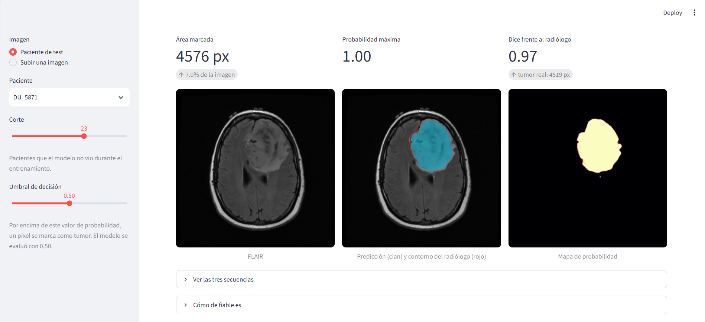
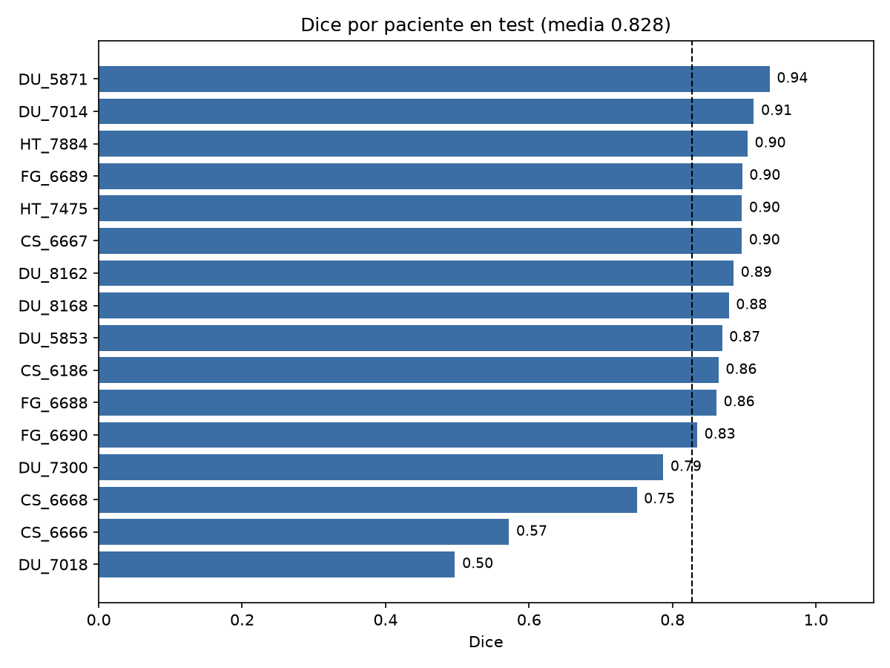
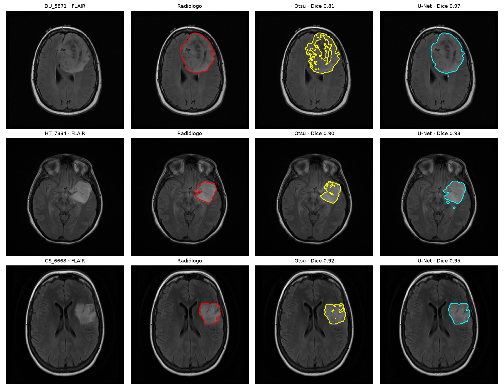
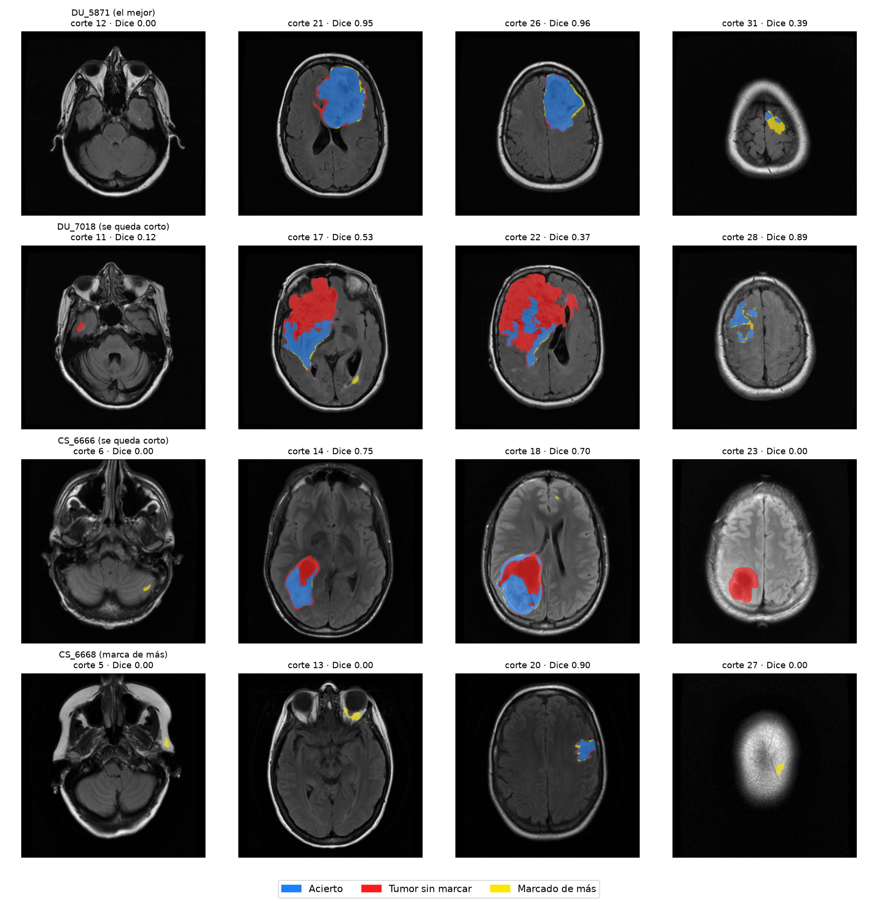
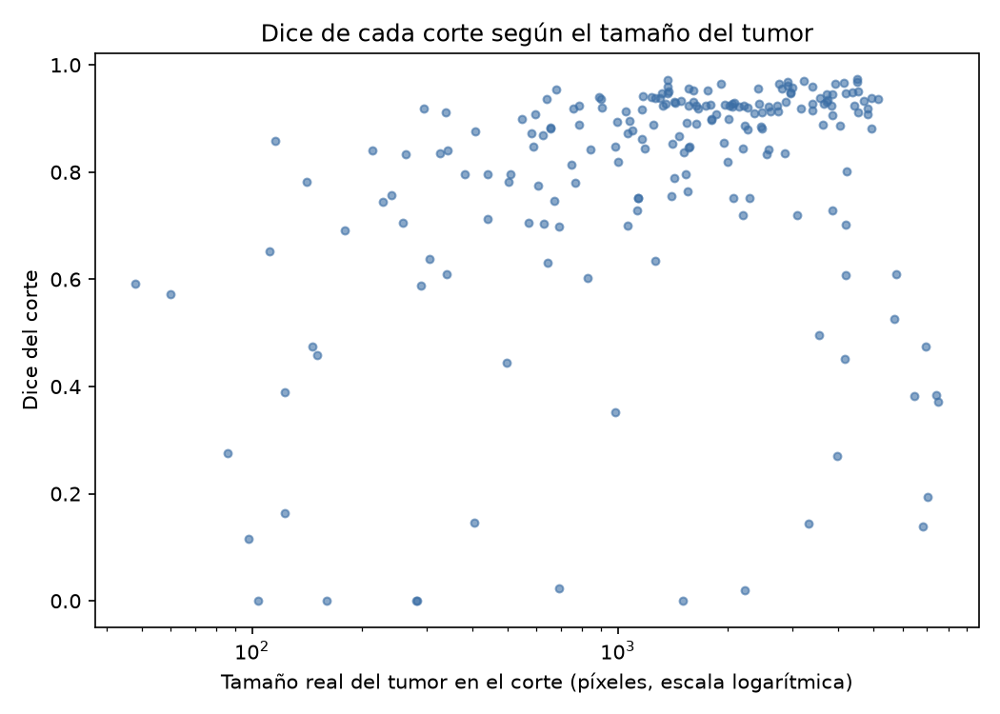
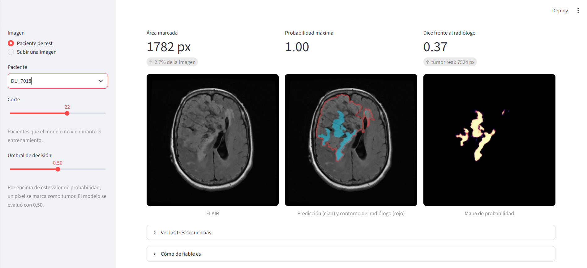

# Segmentación de tumores cerebrales en resonancia magnética

U-Net entrenada desde cero en PyTorch para delimitar gliomas de bajo grado en cortes de resonancia magnética. En 16 pacientes de test que el modelo no vio nunca, alcanza un **Dice medio por paciente de 0,83 ± 0,12** (mediana 0,87).

*Paciente de test DU_5871, corte 23: Dice de 0,97 frente al contorno del radiólogo.*

> Proyecto de aprendizaje. No es una herramienta de diagnóstico ni debe usarse con ese fin.

Autor: Diego Corrales, estudiante de 2.º de Ingeniería Biomédica.

## Resultados en test

Métricas por paciente, sumando los píxeles de todos sus cortes.

| Métrica | Media ± desviación | Mediana |
|---|---|---|
| Dice | 0,828 ± 0,124 | 0,874 |
| IoU | 0,721 ± 0,156 | 0,776 |
| Sensibilidad | 0,843 ± 0,190 | 0,908 |
| Precisión | 0,848 ± 0,077 | 0,860 |

El peor paciente obtiene 0,497 y el mejor 0,935. Doce de los dieciséis superan 0,83.

Como referencia, el trabajo original de este dataset (Buda et al., 2019) informa de un Dice medio del 82 %. Las cifras no son directamente comparables: allí se evaluó sobre los 110 pacientes y aquí sobre 16 con una única división.

## ¿Hacía falta deep learning?

Se comparó con un método clásico sin aprendizaje: umbrales de Otsu encadenados sobre la secuencia FLAIR, más morfología para quitar el cráneo y quedarse con la región brillante más grande.

| | Otsu clásico | U-Net |
|---|---|---|
| Dice | 0,435 ± 0,186 | 0,828 ± 0,124 |
| IoU | 0,294 | 0,721 |
| Sensibilidad | 0,528 | 0,843 |
| Precisión | 0,443 | 0,848 |
| Cortes sanos con algo marcado | 63,0 % | 11,1 % |

La U-Net gana en 15 de los 16 pacientes.

La figura muestra el corte con más tumor de tres pacientes, que es el mejor caso para Otsu: cuando la lesión es una mancha brillante y clara, separar por brillo funciona. La diferencia está en el resto. Un umbral siempre encuentra "lo más brillante" de la imagen, así que marca algo en casi dos de cada tres cortes sanos. Delimitar un tumor evidente no requiere una red neuronal; decidir si hay tumor y dónde, sí. Los parámetros del método clásico se fijaron a mano y no se ajustaron, por lo que podría rendir algo más.

## Cómo falla el modelo

Azul: acierto. Rojo: tumor sin marcar. Amarillo: marcado de más.

**Tumores pequeños.** El rendimiento depende del tamaño de la lesión en el corte.

| Tumor en el corte | Cortes | Dice medio | No detectados |
|---|---|---|---|
| Pequeño (menos de 500 px) | 34 | 0,559 | 11,8 % |
| Mediano (500 a 2000 px) | 87 | 0,839 | 1,1 % |
| Grande (más de 2000 px) | 83 | 0,813 | 0 % |

**Tumores muy grandes y heterogéneos.** En los dos peores pacientes la precisión es alta y la sensibilidad baja: lo que marca es tumor, pero se deja una parte grande. En el caso revisado, el modelo segmenta el componente brillante en FLAIR y asigna probabilidad casi nula al resto de la lesión, de aspecto más apagado. Bajar el umbral de decisión no lo corrige. Es una observación sobre el peor caso, no un resultado general.

*Paciente de test DU_7018, corte 22: el modelo marca 1.782 píxeles de un tumor de 7.524 (Dice de 0,37), con probabilidad máxima de 1,00.*

**Falsos positivos.** Marca algo en 41 de los 368 cortes sanos. Solo 10 están junto al inicio o el final del tumor y 12 son manchas de más de 200 píxeles. Aparecen en estructuras que brillan en FLAIR sin ser lesión, como las órbitas y la base del cráneo, y en los cortes más altos.

## De la primera versión a la segunda

El primer entrenamiento parecía razonable por su métrica (Dice medio por corte de 0,78), pero al desglosarlo resultó ser un modelo que casi no segmentaba. Estos son los datos en validación.

| | Versión 1 | Versión 2 |
|---|---|---|
| Dice por paciente | 0,527 | 0,816 |
| Cortes con tumor no detectados | 35,3 % | 4,7 % |
| Cortes sanos con algo marcado | 2,6 % | 7,1 % |

Lo que se aprendió por el camino:

- **La métrica engañaba.** Dos de cada tres cortes no tienen tumor, y un corte vacío sin marcas cuenta como Dice 1. Un modelo que no marca nada sacaba 0,62. Se pasó a medir por paciente.
- **El criterio de selección premiaba no marcar.** Al guardar el mejor modelo según esa métrica, se elegía el más prudente.
- **El brillo depende del escáner.** Tres pacientes de un mismo hospital, con imágenes más oscuras, tenían Dice 0. Normalizar cada canal de cada imagen los llevó a 0,82, 0,82 y 0,93.

La versión 2 cambia cinco cosas a la vez: normalización por imagen, muestreo que equilibra cortes con y sin tumor, selección por Dice por paciente, tasa de aprendizaje decreciente y más épocas. Como se aplicaron juntas, no se sabe cuánto aporta cada una.

## Datos

LGG Segmentation Dataset: resonancias de 110 pacientes con glioma de bajo grado de The Cancer Genome Atlas, procedentes de 5 instituciones. Son 3.929 cortes de 256×256 con tres canales (precontraste, FLAIR y poscontraste) y una máscara dibujada por un radiólogo. El 34,9 % de los cortes contiene tumor.

La división se hace **por paciente**, no por corte, para que cortes vecinos del mismo cerebro no acaben en conjuntos distintos: 78 pacientes para entrenar, 16 para validar y 16 para test (2.744, 613 y 572 cortes). El conjunto de test se evaluó una sola vez, con el modelo ya cerrado.

## Modelo y entrenamiento

- **Arquitectura:** U-Net de cuatro niveles con 32 filtros base y normalización por lotes. 7.763.041 parámetros.
- **Pérdida:** entropía cruzada binaria más Dice.
- **Optimización:** Adam, tasa de aprendizaje de 0,001 con descenso en coseno, lotes de 16 y 60 épocas.
- **Aumentos:** volteo horizontal y giros de hasta 15 grados.
- **Equipo:** GPU T4 de Google Colab, unos 67 segundos por época. Se guarda la época con mejor Dice por paciente en validación (la 44).

## Cómo reproducirlo

Requiere Python 3.10 o superior. El desarrollo se hizo con Python 3.14 y PyTorch 2.14 en Windows.

    python -m venv .venv
    .venv\Scripts\activate
    pip install -r requirements.txt

Descarga el dataset desde Kaggle (enlace en las referencias) y extráelo de forma que quede la carpeta `data/kaggle_3m`.

    python src/preparar_datos.py
    python src/entrenar_completo.py
    python src/evaluar_test.py
    python src/analisis_errores.py
    python src/metodo_clasico.py

El repositorio incluye el modelo entrenado (`modelos/unet_v2.pt`), así que el entrenamiento se puede saltar. Entrenar sin GPU lleva horas.

Para abrir la demo:

    streamlit run app.py

## Estructura

    app.py                    Demo con Streamlit
    requirements.txt
    src/
      preparar_datos.py       División por paciente
      dataset.py              Carga, normalización y aumentos
      unet.py                 Arquitectura
      perdida.py              Pérdida y métrica Dice
      entrenar.py             Bucle de entrenamiento y evaluación
      entrenar_completo.py    Entrenamiento final
      diagnostico.py          Desglose de resultados en validación
      evaluar_test.py         Evaluación en test
      analisis_errores.py     Análisis de errores
      metodo_clasico.py       Comparación con Otsu
      inferencia.py           Carga del modelo y predicción
      explorar.py             Visualización de un corte
    modelos/                  Modelo entrenado e historial
    resultados/               Métricas y figuras

## Limitaciones

- Un solo tipo de tumor (glioma de bajo grado) y un solo dataset.
- Cortes 2D independientes: el modelo no usa la información de los cortes vecinos.
- Conjunto de test pequeño, de 16 pacientes, con una única división. Las medias tienen una incertidumbre considerable.
- La normalización se hace corte a corte. En los cortes con muy poco cerebro estira demasiado el contraste, lo que puede explicar parte de los falsos positivos. Normalizar por paciente completo es la mejora más clara.
- No se ha aplicado posprocesado. Eliminar regiones pequeñas reduciría parte de los falsos positivos, pero solo una tercera parte son manchas de menos de 50 píxeles.

## Referencias

- M. Buda, A. Saha, M. A. Mazurowski. "Association of genomic subtypes of lower-grade gliomas with shape features automatically extracted by a deep learning algorithm". Computers in Biology and Medicine, 2019. https://arxiv.org/abs/1906.03720
- Dataset: https://www.kaggle.com/datasets/mateuszbuda/lgg-mri-segmentation. Su licencia y condiciones de uso están en esa página.